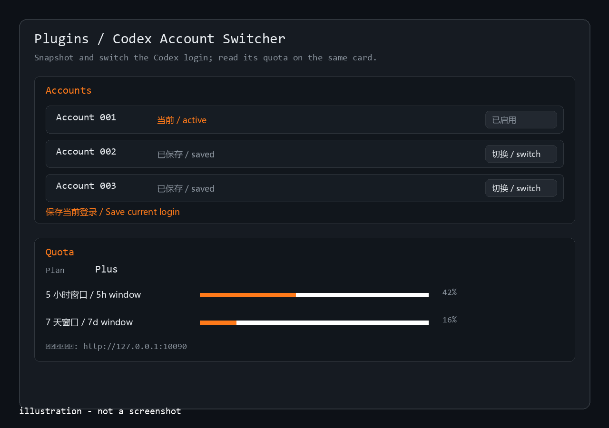

# DSH Codex Account Switcher

鍦?DSH 鐨?**Plugins 椤甸潰**涓婄鐞?Codex 瀛愭櫤鑳戒綋浣跨敤鐨勭櫥褰曡处鍙凤細鎶婂綋鍓?`auth.json` 淇濆瓨涓哄懡鍚嶅揩鐓с€佸湪璐﹀彿涔嬮棿鍒囨崲锛屽苟璇诲彇璇ヨ处鍙风殑 Codex 棰濆害锛坮ate limits锛夈€?
> English: see [README.en.md](README.en.md).



*示意图：插件卡片里的账号快照/切换与额度显示。图片由 docs/images/generate.py 用代码生成，不是截图，不含真实账号数据。*

## 鍔熻兘

- **璐﹀彿蹇収**锛氭妸 `$CODEX_HOME/auth.json`锛堥粯璁?`~/.codex/auth.json`锛夊綋鍓嶇櫥褰曚繚瀛樹负鍛藉悕璐﹀彿锛屼箣鍚庡彲涓€閿垏鍥炪€?- **鍒囨崲璐﹀彿**锛氶€夋嫨鏌愪釜璐﹀彿鍚庯紝鎻掍欢浼氭妸瀹冪殑 `auth.json` 鍐欏洖 Codex home锛涘垏鎹㈠墠浼氭妸褰撳墠鐧诲綍鑷姩澶囦唤鍒?`<璐﹀彿鐩綍>/_auto/<鏃堕棿鎴?/`銆?- **棰濆害鏄剧ず**锛氶€氳繃 Codex 鑷甫鐨?app-server 璇诲彇 `account/rateLimits/read`锛屽湪鎻掍欢鍗＄墖閲屾樉绀哄椁愩€? 灏忔椂/7 澶╃敤閲忎笌閲嶇疆鏃堕棿銆?- **浠ｇ悊璁剧疆**锛氳鍙栭搴﹂渶瑕佽兘杩炰笂 OpenAI锛屽彲鍦ㄦ彃浠堕厤缃噷濉?HTTP 浠ｇ悊锛堜緥濡?`http://127.0.0.1:10090`锛夛紱鐣欑┖鑷姩璺熼殢绯荤粺浠ｇ悊鐜鍙橀噺銆?
## 瀹夎

```bash
dsh plugin --profile desktop add github:BuildWithAIHub/dsh-codex-account-switcher
```

DSH Desktop 涔熷彲浠ュ湪 **Settings 鈫?Plugins** 閲岀矘璐翠笂闈㈢殑 GitHub 鍦板潃瀹夎銆傝瀹屽埛鏂伴〉闈㈡垨閲嶅惎 DSH銆?
瑕佹眰锛欴SH `>= 0.2.1-rc.1`锛屼笖鏈満宸叉湁鍙敤鐨?Codex 鐧诲綍銆?
## 鏁版嵁涓庡畨鍏紙閲嶈锛?
- 璐﹀彿蹇収榛樿瀛樻斁鍦?`~/.codex-accounts/`锛堝彲鍦ㄦ彃浠堕厤缃噷鏀癸級锛屽揩鐓у唴瀹瑰氨鏄?**`auth.json` 鐨勫畬鏁存嫹璐濓紝鍖呭惈 Codex 鐨?OAuth token**銆傝鍍忓寰呭瘑鐮佷竴鏍蜂繚鎶よ繖涓洰褰曘€?- 鍒囨崲璐﹀彿浼氳鐩?`~/.codex/auth.json`锛涙瘡娆¤鐩栧墠鎻掍欢浼氬厛鍋氫竴浠借嚜鍔ㄥ浠斤紙`_auto/` 鐩綍锛夈€?- 鎻掍欢**娌℃湁**绗笁鏂归仴娴嬫垨涓婁紶浠ｇ爜锛涘敮涓€鐨勭綉缁滆涓烘槸璇诲彇棰濆害鏃惰皟鐢?Codex 鑷繁鐨勫悗绔紙涓?Codex 瀹㈡埛绔浉鍚岋紱娌℃湁缃戠粶/浠ｇ悊鏃朵細鏄剧ず"鏈煡"鑰屼笉鏄姤閿欏崱姝伙級銆?- 鏈彃浠朵笌 OpenAI / DeepSeek 鍧囨棤鍏宠仈锛屼娇鐢ㄩ闄╄嚜璐熴€?
## 璁稿彲

MIT锛岃 [LICENSE](LICENSE)銆?